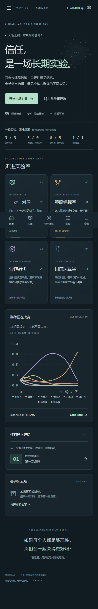

# TRUST LAB · 信任实验室

**合作、欺骗与理性的演化实验**

[立即体验网页](https://chen-yy2008.github.io/trust-lab/) · [完整源代码](https://github.com/chen-yy2008/trust-lab)

一个中文、免费、无需后端的博弈论互动游戏与实验平台。你亲自选择合作或背叛，也可以让八种公开规则策略对战，观察收益、排名与群体演化。


## 你可以做什么

- 七个原创互动章节：单次困境、重复相遇、宽恕、误判、锦标赛、演化和自由实验。
- 对局室：手动合作 / 背叛、自动策略播放、暂停、继续、单步、重置、策略揭晓、行动时间线与复盘。
- 八种真实策略：永远合作、永远背叛、以牙还牙、宽容互惠、记仇者、赢则保持输则改变、可配置随机策略、具有历史条件的伪装机会主义者。
- 策略循环赛：可选阵容、自我对弈、多次重复、排名、收益与合作率热力图、逐轮日志、前后排名变化。
- 合作演化：真实交锋矩阵、离散复制子—均匀变异更新、世代播放、时间滑块、期望收益与群体组成。
- 自由实验：收益矩阵、噪声、终止规则、策略参数、初始权重、选择强度、变异和种子；双条件真实计算与比较。
- 策略图鉴：算法、优势、弱点、环境与实时交锋样本；配套简明概念说明。
- 实验档案：本机保存、重命名、复制、删除、双报告对照、JSON 导入 / 导出与原始 CSV 导出。损坏存档安全回退；删除需确认。
- 320px 起的手机布局、底部导航、可滚动宽表格、键盘焦点与减弱动画设置。

全部模拟在浏览器本地完成。对手是**明确的规则算法**，不使用大语言模型 API，不具有自主意识。没有账户系统、跟踪分析或付费服务。浏览器与设备之间不会自动同步存档；最多保留 100 份记录，请定期导出 JSON。

## 本地运行

推荐 Node.js 24 LTS（最低满足 Vite 7 的 Node 版本要求）。Windows PowerShell、macOS 和 Linux 均可使用：

```sh
npm install
npm run dev
```

开发地址默认是 `http://127.0.0.1:5173`。

```sh
npm test                 # 数学、策略、采样、演化、档案测试
npm run typecheck        # TypeScript
npm run build           # 生产构建至 dist/
npm run preview         # 生产预览
npx playwright install chromium
npm run test:e2e        # 8 个视口、8 个页面与核心交互
```

首次运行 E2E 会将实际页面截图写入 `docs/screenshots/`。浏览器测试配置包含自启动的本地 Vite 服务。

## 规则与可复现性

默认收益：双方合作 R=3；单方背叛得 T=5、被利用者 S=0；双方背叛 P=1。满足 T>R>P>S 和 2R>T+S。自由实验允许其他有限收益，并提示是否仍属于标准囚徒困境。

双方的意图都在同一份已结束历史上决定，再独立施加行动噪声，最后计算收益。对手无法读取玩家当轮尚未揭晓的行动。随机终止在每轮结束后以 stop 概率判定，rounds 是最大上限。随机数使用本地种子 PRNG；同参数、策略与种子可复现，日期与报告 UUID 不参与计算。

赢则保持策略：上轮收益为 R 或 T 时保持自己的实际行动，否则切换。机会主义者：前 disguise 轮合作；此后每轮检查对方最近三次行动，至少两次合作时以 exploit 概率背叛，否则合作；不满足历史条件则复制对手上一轮。默认 disguise=3、exploit=0.8。没有对局外的隐藏学习或状态。

循环赛包含自我对弈：异类交锋分别计入双方收益，同类取两侧均值并计为一次交锋。按总收益 / 总实际回合排序；随机终止下场长可不同，合作率按实际回合加权。热力图为行方视角，所有原始回合保存在报告中。

## 演化模型

首先通过真实重复交锋估计矩阵 A，并在一次演化运行中保持固定。令 x 为策略频率：

```text
π_i = Σ_j A_ij x_j
π̄ = Σ_i x_i π_i
f_i = exp(β × (π_i − π̄))
y_i = x_i f_i / Σ_j x_j f_j
x_i' = (1 − μ) y_i + μ / M
```

M=8。计算使用 log-sum-exp，避免高选择压力溢出；归一化后频率非负、总和为 1。初始权重可代表相对群体组成，绝对人口数不影响无限群体模型。

这是离散时间、无限充分混合群体、固定对战矩阵、均匀变异的简化模型。收益矩阵是有限采样估计，随机策略的估计误差会受回合与重复次数影响。不包含有限群体漂变、网络结构、声誉、制度或现实心理；不能将模拟结果当作现实社会的普遍规律。

## 部署到 GitHub Pages

main 分支推送自动触发 `.github/workflows/deploy.yml`：`npm ci` → 规则测试 → TypeScript 与生产构建 → 上传 Pages 构建产物 → 部署。

仓库 Settings → Pages 的 Source 应选择 **GitHub Actions**。Vite 使用 `base: './'`，页面采用 hash 导航，支持 `/<repo>/` 项目站点、静态托管与刷新子页面。部署状态见 [Actions](https://github.com/chen-yy2008/trust-lab/actions)。

## 源码结构

```text
src/engine.ts       纯 TypeScript 规则、锦标赛、演化
src/storage.ts      存档校验、恢复、JSON / CSV
src/components.tsx  表单、SVG 网络与图表
src/Duel.tsx        对局和复盘
src/Experiments.tsx 锦标赛、演化、双条件实验
src/Learning.tsx    互动章节和图鉴
src/App.tsx         导航、首页、档案与设置
tests/             Playwright 响应式和功能验收
```

## 开源与素材

代码使用 MIT 许可证。图标来自 Lucide；品牌视觉、中文叙事、SVG 网络与图表为本项目原创。未复用 The Evolution of Trust 的界面、故事、音频或图片。完整依赖版本、来源和版权许可见 [THIRD_PARTY_NOTICES.md](THIRD_PARTY_NOTICES.md) 与 [THIRD_PARTY_LICENSES.txt](THIRD_PARTY_LICENSES.txt)。通过 `node scripts/notices.mjs` 可依据锁文件及已安装依赖重新生成。


